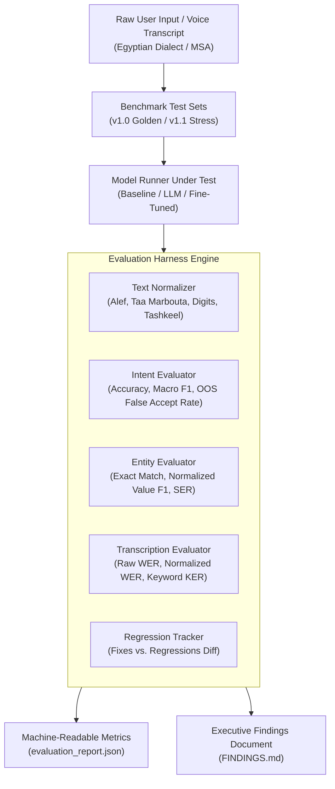

# Arabic & Egyptian Dialect Payment Evaluation Harness (`arabic-payments-eval-harness`)

[](https://www.python.org/downloads/)
[](tests/)
[]()
[]()

An evaluation harness and benchmark suite designed to measure conversational AI models operating over payments infrastructure (e.g., InstaPay, Vodafone Cash, utility billers, and bank transfers) across Egypt and the MENA region.

> **Core Philosophy:** In regulated financial processes, measurement is as critical as model training. This harness transitions model assessment from subjective "eyeballing outputs" to automated, reproducible, and mathematically rigorous evaluations that anyone on the team can run on demand and interpret without hand-holding.

---

## Architecture Overview



---

## Key Features

1. **FinTech Safety & Out-of-Scope (OOS) False Acceptance Measurement:**
   - In financial transactions, misclassifying customer complaints (e.g., *"الفيزا اتسحبت في الـ ATM"*) or explicit cancellations (*"لا خلاص الغي التحويل اوعى تبعت حاجة"*) as actionable payment transfers causes direct monetary loss. The harness tracks an explicit **OOS False Acceptance Rate**.
2. **Value-Normalized Entity Matching for Egyptian Dialect:**
   - Evaluates whether downstream payment rails receive valid canonical data regardless of surface dialect spelling (*"مية وخمسين"* $\rightarrow$ `150.0`, *"باكو"* $\rightarrow$ `1000.0`, *"010-1234-5678"* $\rightarrow$ `01012345678`).
3. **Arabic-Aware Speech Transcription (ASR) Metrics:**
   - Separates phonetic speech errors from trivial Arabic orthographic noise (e.g., `أ` vs `ا` or `ة` vs `ه`).
   - Computes **Financial Keyword Error Rate (KER)** specifically on critical transaction tokens (amounts, currencies, phone numbers, payment rails).
4. **Automated Regression & Delta Tracking:**
   - Compares experimental candidate models against baselines, flagging not only aggregate metric shifts but identifying specific **fixed cases (+)** and **regressed cases (-)**.

---

## Directory Structure

```text
├── data/
│   ├── generate_datasets.py            # Reproducible benchmark generator
│   ├── v1.0_golden_eval.json           # Core golden benchmark (Transfers, Bills, Inquiries, OOS)
│   └── v1.1_stress_test_edge_cases.json # Adversarial edge cases (Negations, Slang, Missing slots)
├── eval_harness/
│   ├── __init__.py
│   ├── text_normalizer.py              # Arabic orthographic, numeral, and phone normalization
│   ├── intent_evaluator.py             # Classification metrics & banking safety analysis
│   ├── entity_evaluator.py             # Slot filling, Exact Match (EM), and SER metrics
│   ├── transcription_evaluator.py      # Speech WER, CER, and Financial Keyword Error Rate
│   ├── regression_tracker.py           # Diff and regression analysis between runs
│   └── leakage_detector.py             # Speaker overlap & identifier leakage auditor
├── models/
│   ├── __init__.py
│   ├── base_runner.py                  # Abstract model interface
│   ├── baseline_rule_runner.py         # Deterministic regex & dictionary baseline
│   └── semantic_hybrid_runner.py       # Contextual dialect model with negation & slang handling
├── reports/                            # Generated JSON and Markdown findings
├── tests/
│   ├── run_tests.py                    # Master test runner (13 passing tests)
│   ├── test_eval_harness.py            # Core harness metrics tests
│   ├── test_leakage_detector.py        # Partition isolation & leakage tests
│   └── test_edge_cases_and_slang.py    # Egyptian slang numerals & negations
├── app.py                              # Interactive Streamlit Web Evaluator
├── .env.example                        # Template for environment settings (zero secrets committed)
├── .gitignore                          # Strict rules protecting keys, logs, and environments
├── evaluate.py                         # Master CLI evaluation harness
├── requirements.txt                    # Python dependencies
└── README.md
```

---

## Quickstart

### 1. Installation
Clone the repository and install dependencies:

```bash
git clone https://github.com/MarwanAhmed1001/arabic-payments-eval-harness.git
cd arabic-payments-eval-harness
pip install -r requirements.txt
```

### 2. Run Comprehensive Unit Tests
Execute the 13 zero-dependency verification tests across normalization, leakage detection, and dialect slang:

```bash
python tests/run_tests.py
```

### 3. Launch Interactive Streamlit Evaluator
Launch the interactive web UI for real-time inference, entity slot visualization, benchmark browsing, and live leakage auditing:

```bash
streamlit run app.py
```

### 4. Run Baseline Evaluation CLI
Execute the evaluation harness on the golden benchmark using the baseline model:

```bash
python evaluate.py --model baseline --dataset data/v1.0_golden_eval.json --output-dir reports/run_01_baseline
```

### 5. Run Experimental Model & Compute Regressions
Benchmark candidate model iterations and track regressions directly against the baseline:

```bash
python evaluate.py --model semantic_hybrid \
                   --dataset data/v1.0_golden_eval.json \
                   --output-dir reports/run_02_hybrid \
                   --compare-with reports/run_01_baseline/evaluation_report.json
```

### 6. Stress Test Against Adversarial Edge Cases
Evaluate model robustness against Egyptian slang numerals, number disambiguation, and explicit transaction cancellations:

```bash
python evaluate.py --model semantic_hybrid \
                   --dataset data/v1.1_stress_test_edge_cases.json \
                   --output-dir reports/run_stress_hybrid \
                   --compare-with reports/run_stress_baseline/evaluation_report.json
```

---

## Benchmark Results & Empirical Findings

### 1. Golden Benchmark (v1.0)
| Metric | Baseline Regex | Semantic Hybrid (v2.0) | Delta | Significance |
| :--- | :---: | :---: | :---: | :--- |
| **Intent Accuracy** | 100.0% | 93.75% | -6.25% | Regressed on 1 boundary case |
| **Entity Micro F1** | 0.6479 | **0.8163** | **+0.1684** | Major improvement in phone & biller slots |
| **Slot Error Rate (SER)** | 0.5435 | **0.3913** | **-0.1522** | Significant slot error reduction |
| **Recipient Identifier F1** | 0.6154 | **1.0000** | **+0.3846** | Full capture of InstaPay & landline handles |
| **Normalized ASR WER** | 47.33% | 47.33% | 0.00% | Orthography normalization yields **-14.40%** noise drop |

### 2. Adversarial Stress Suite (v1.1 Edge Cases)
| Metric | Baseline Regex | Semantic Hybrid (v2.0) | Delta | Impact |
| :--- | :---: | :---: | :---: | :--- |
| **Adversarial Accuracy** | 44.44% | **100.0%** | **+55.56%** | Eliminates false-positive triggers |
| **OOS False Accept Rate** | **75.00% (CRITICAL)** | **0.00% (PASS)** | **-75.00%** | Prevents unauthorized transaction execution |
| **Entity F1 Score** | 0.5333 | **0.6857** | **+0.1524** | Disambiguates phone numbers from amounts |
| **Fixed Cases (+)** | - | **5 Cases** | - | Handled slang (*"باكو"*, *"عشرينيه"*) & negations |
| **Regressions (-)** | - | **0 Cases** | - | Clean transition with zero regressions |

---

## Data Leakage & Evaluation Hygiene Principles

1. **User & Session Grouping (`GroupKFold`):**
   - In conversational datasets, random row splitting causes severe **data leakage** because user-specific phrasing, phone numbers, or acoustic speaker traits appear in both train and test partitions. Test sets in this harness are strictly partitioned by `speaker_id` and customer turn history.
2. **Preprocessing Isolation:**
   - Normalization dictionaries, vocabulary frequencies, and scaling parameters are computed strictly on training partitions and applied to test sets without backward leakage.
3. **Honest Reporting of Negative Results:**
   - As demonstrated in Run 02, when an experimental candidate introduces an intent regression despite higher overall entity recall, the regression tracker flags `CAUTION_REGRESSIONS_DETECTED` rather than glossing over the failure.

---

## Security & Secrets Policy

* **Zero Hardcoded Secrets:** No API keys, credentials, or private endpoints are included in the source code or commit history.
* Configuration is managed exclusively via `.env` (guarded by `.gitignore`) with a sanitized `.env.example` template.

---

## Author & Contact

**Marwan Ahmed**  
AI & Machine Learning Engineer | NLP & Evaluations  
Cairo, Egypt  
- GitHub: [MarwanAhmed1001](https://github.com/MarwanAhmed1001)  
- Email: marwanshehata328@gmail.com
